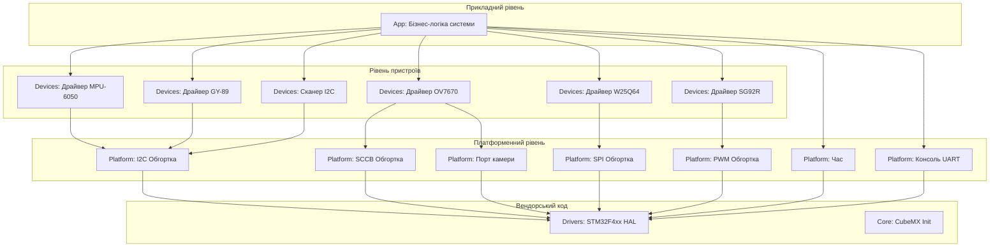

# Архітектура програмного проєкту

## 1. Діаграма компонентів (Component Diagram)
Нижче наведено структуру шарів нашого проєкту. Стрілки вказують напрямок залежностей.

## 2. Опис шарів та правила залежностей

Проєкт побудовано за принципом суворої шаруватої архітектури. Залежності можуть бути спрямовані виключно зверху вниз.

*   **App (Прикладний рівень):** Містить головну логіку продукту: самоперевірку на старті, обробку UART-команд, головний цикл. Цей шар нічого не знає про мікроконтролер, його регістри чи бібліотеку HAL. З пристроями він працює виключно через шар `Devices` (наприклад, "отримати температуру", "встановити кут сервопривода"). Із шару `Platform` він використовує лише час і консоль UART.
*   **Devices (Драйвери сенсорів):** Містить логіку роботи з конкретними чіпами (читання регістрів ID, розрахунок фізичних величин). Драйвери є платформонезалежними і можуть бути перенесені на інший МК.
*   **Platform (Адаптація до плати):** Єдиний шар, де зберігається знання про конкретну плату (номери пінів, хендли периферії, такі як `hi2c1`, `hspi2`). Цей шар надає універсальні інтерфейси (наприклад, `Platform_I2C_ReadReg()`), які всередині викликають функції HAL.
*   **Drivers & Core:** Згенерований вендорський код (STM32CubeMX). `main.c` після ініціалізації периферії передає керування в `App_Init()` і `App_Poll()`.

| Шар | Може підключати | Не може підключати |
|---|---|---|
| `App` | `Devices/*`; з `Platform` — лише `platform_time.h` і `platform_board.h` | HAL, `main.h`, `platform_i2c/spi/pwm/sccb/camera.h` |
| `Devices` | `Platform/*` | HAL, `main.h`, `App/*` |
| `Platform` | HAL, `main.h` | `Devices/*`, `App/*` |
| `Core` | усе | — |

Шини належать драйверам, тому `App` звертається до них лише через `Devices`. Час і консоль UART не належать жодному пристрою, тому `App` бере їх напряму з `Platform`. Заголовки `platform_*.h` не містять типів HAL, тож `App` і далі не знає про HAL.

## 3. Автоматичний контроль
Для того, щоб унеможливити порушення архітектури, у проєкті реалізовано автоматичну перевірку правил залежностей `make check-arch`. Вона запускається перед кожною збіркою і зупиняє її з помилкою, якщо знаходить у шарах `App` чи `Devices` підключення заголовків HAL або `main.h` чи виклики функцій HAL, а також якщо `App` звертається до шин (I2C, SPI, PWM, SCCB, порт камери) в обхід драйверів.

## 4. Доступ до шини
Драйвер сенсора (шар `Devices`) не викликає `HAL_I2C_Mem_Read` напряму. Натомість він викликає функції шару `Platform` (`Platform_I2C_ReadReg`, `Platform_SPI_Xfer`, `sccb_read_reg` тощо), оголошені без жодного типу HAL. На платі ці функції працюють через HAL, а в хостових тестах замість них компонуються fake або mock-об'єкти з тими самими іменами. Завдяки цьому драйвери легко тестувати на хості. Функції `Platform` повертають `bool`, тому драйвер не відрізняє NACK від тайм-ауту.

## 5. Знання про плату
Номери пінів і хендли периферії використовуються лише в шарі `Platform` і в коді CubeMX (`Core`). Хендли (`hi2c1`, `hspi2`, `huart2` тощо) і піни кнопки та світлодіода генерує CubeMX з `firmware.ioc`, а піни SCCB, камери і SPI описано у файлі `Platform`, який з ними працює. Повна таблиця пінів з обґрунтуванням — `docs/pinout.md`.

## 6. Повторна генерація STM32CubeMX
Власний код у `Core/Src/main.c` записано лише між мітками `USER CODE BEGIN` / `USER CODE END`, тому повторна генерація з `firmware.ioc` його не знищить. Уся логіка живе в `App`, `Devices` і `Platform`, яких CubeMX не торкається. Обмеження: `firmware/Makefile` CubeMX теж генерує, тож після повторної генерації в ньому треба відновити списки файлів і ціль `check-arch`.
