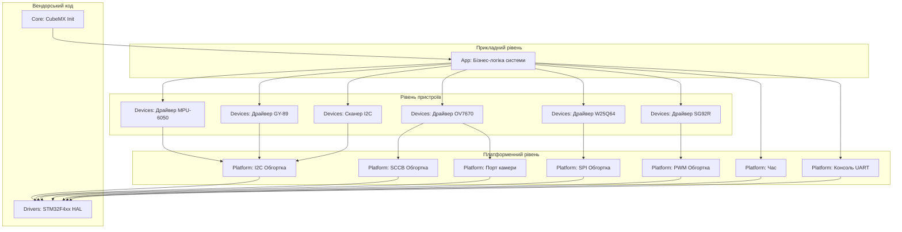

# Архітектура програмного проєкту

## 1. Діаграма компонентів (Component Diagram)
Нижче наведено структуру шарів нашого проєкту. Стрілки вказують напрямок залежностей.

З усього шару `Platform` прикладний рівень використовує лише час і консоль UART, до шин він звертається через драйвери (див. 2.1).

## 2. Опис шарів та правила залежностей

Проєкт побудовано за принципом шаруватої архітектури. Залежності можуть бути спрямовані виключно зверху вниз.

*   **App (Прикладний рівень, `firmware/App/`):** Містить головну логіку продукту: самоперевірку на старті, обробку UART-команд, передачу кадрів на комп'ютер, головний цикл. Цей шар нічого не знає про мікроконтролер, його регістри чи бібліотеку HAL. З пристроями він працює виключно через шар `Devices` (наприклад, "отримати температуру", "встановити кут сервопривода").
*   **Devices (Драйвери сенсорів, `firmware/Devices/`):** Містить логіку роботи з конкретними чіпами (читання регістрів ID, розрахунок фізичних величин). Драйвери є платформонезалежними і можуть бути перенесені на інший МК.
*   **Platform (Адаптація до плати, `firmware/Platform/`):** Єдиний шар, де зберігається знання про конкретну плату (номери пінів, хендли периферії, такі як `hi2c1`, `hspi2`). Цей шар надає універсальні інтерфейси (наприклад, `Platform_I2C_ReadReg()`), які всередині викликають функції HAL.
*   **Drivers & Core:** Згенерований вендорський код (STM32CubeMX). `Core/Src/main.c` лише ініціалізує периферію, друкує заставку і передає керування в `App_Init()` / `App_Poll()`.

### 2.1. Хто кого може підключати (`#include`)

| Шар | Може підключати | Не може підключати |
|---|---|---|
| `App` | `Devices/*`; з `Platform` — лише `platform_time.h` і `platform_board.h` | HAL, `main.h`, `platform_i2c/spi/pwm/sccb/camera.h` |
| `Devices` | `Platform/*` | HAL, `main.h`, `App/*` |
| `Platform` | HAL, `main.h` | `Devices/*`, `App/*` |
| `Core` | усе | — |

Чому `App` може звертатися до частини `Platform`. Шини (I2C, SPI, SCCB, PWM, паралельний порт камери) належать драйверам, тому `App` до них не звертається, інакше шар `Devices` втратив би сенс. Час (затримки, мілісекунди) і консоль UART не належать жодному пристрою, тому `App` бере їх напряму з `Platform`. Заголовки `platform_*.h` не містять типів HAL, тож `App` і далі не знає про HAL і тестується на комп'ютері з підміною цих функцій.

Один виняток: `ov7670_capture.h` (Devices) підключає `platform_camera.h` заради констант розміру буфера кадру (`STRIP_LINES`, `MAX_LINE_BYTES`, `SNAP_W/H`, `CAM_BUF_BYTES`). Розмір буфера визначає плата (обсяг SRAM), тому константи лежать у `Platform`. `App` читає ці константи, але функцій порту камери (`cam_*`, `Camera_*`) не викликає.

## 3. Автоматичний контроль
Для того, щоб унеможливити порушення архітектури, у проєкті реалізовано автоматичну перевірку правил залежностей `make check-arch` (`firmware/Makefile`). Вона виконується перед кожною збіркою (`make build` → `make -C firmware all` → `check-arch`) і зупиняє збірку з помилкою, якщо:

1. файл у `App/` чи `Devices/` підключає заголовки HAL (`stm32f4xx*`) або `main.h` (через нього підключається HAL);
2. файл у `App/` чи `Devices/` викликає функцію HAL (`HAL_...(`, `__HAL_...(`);
3. файл у `App/` підключає `platform_i2c/spi/pwm/sccb/camera.h` або викликає `Platform_I2C_*`, `Platform_SPI_*`, `Platform_PWM_*`, `sccb_*`, `cam_*`, `Camera_*`.

Обмеження перевірки: вона текстова (grep), тому не бачить залежностей через макроси чи непрямі підключення заголовків. Шар `Core` не перевіряється, бо йому дозволено все.

## 4. Доступ до шини
Драйвер сенсора (шар `Devices`) не викликає `HAL_I2C_Mem_Read` напряму. Натомість він викликає функції шару `Platform` з фіксованими іменами: `Platform_I2C_ReadReg`, `Platform_I2C_WriteReg`, `Platform_SPI_*`, `Platform_PWM_*`, `sccb_read_reg`/`sccb_write_reg`. Їх оголошено в `Platform/Inc/platform_*.h` без жодного типу HAL.

На платі ці функції реалізовано в `Platform/Src/platform_*.c` через HAL. У хостових тестах (`tests/`) замість цих файлів компонуються test doubles з `tests/doubles/` (`fake_i2c.c`, `mock_spi.c`, `fake_sccb.c`, ...) з тими самими іменами функцій. Тобто реалізацію шини підмінюємо на етапі компонування, а не через вказівники на функції: так простіше, а для наших драйверів, кожен з яких працює з однією шиною, цього достатньо. Так само тести `App` підміняють увесь шар `Devices` заглушкою `tests/doubles/stub_devices.c`.

Обмеження: функції `Platform_*` повертають `bool`, тому драйвер не може відрізнити NACK від тайм-ауту.

## 5. Знання про плату
Номери пінів і хендли периферії використовуються лише в `Platform/Src/` і `Core/`:

| Що | Де |
|---|---|
| Хендли `hi2c1`, `hspi2`, `htim1`, `htim3`, `huart2` | оголошено в `Core/Src/main.c` (генерує CubeMX), використовуються через `extern` у `platform_*.c` |
| Піни кнопки B1 і світлодіода LD2 | `Core/Inc/main.h` (генерує CubeMX з `.ioc`) |
| SCCB PB8/PB9 | `Platform/Src/platform_sccb.c` |
| Камера: VSYNC, HREF, PCLK, D0..D7, RESET, PWDN, XCLK PA8 | `Platform/Src/platform_camera.c` |
| SPI2 і CS PB12 | `Platform/Src/platform_spi.c` |

Окремого файлу «pin mapping» немає. Піни, які налаштовує CubeMX, задаються в `firmware.ioc` і потрапляють у `main.h`, а піни, які налаштовує наш код, описано у файлі `Platform`, що з ними працює. Повна таблиця з обґрунтуванням — `docs/pinout.md`.

## 6. Код STM32CubeMX і повторна генерація
`Core/` і `Drivers/` генерує STM32CubeMX з `firmware/firmware.ioc`. Щоб повторна генерація не знищила нашу роботу:

*   власний код у `Core/Src/main.c` записано лише між мітками `/* USER CODE BEGIN ... */` і `/* USER CODE END ... */`: CubeMX зберігає вміст цих секцій і перезаписує все інше;
*   у `main.c` лишилися тільки підключення заголовків, заставка з частотами та виклики `App_Init()` / `App_Poll()`; уся логіка живе в `App/`, `Devices/`, `Platform/`, яких CubeMX не торкається;
*   таймер XCLK для камери (TIM1, PA8) налаштовує `Camera_XclkStart()` у `platform_camera.c`, а не функція в `main.c`.

Обмеження: `firmware/Makefile` CubeMX теж генерує. Після повторної генерації в ньому треба відновити списки файлів `App/`, `Devices/`, `Platform/` і ціль `check-arch`.
